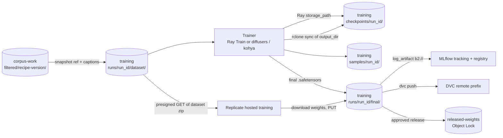
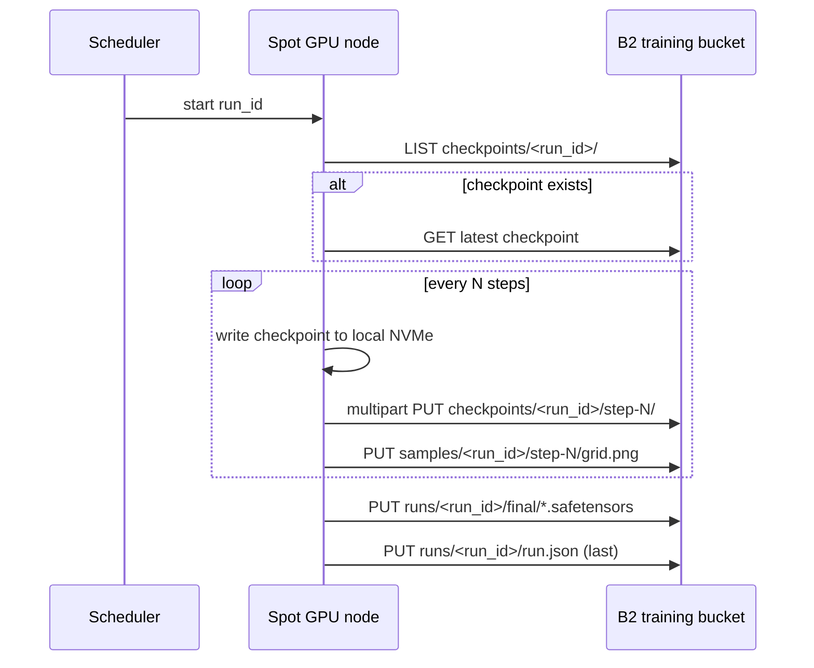

# Fine-tune LoRA and diffusion models with versioned checkpoints

## Workload

Teams fine-tune diffusion models (LoRA, DreamBooth or full fine-tunes of SD-family or FLUX-family models) on curated subsets. A run produces a dataset snapshot and captions, periodic checkpoints (MB-scale for LoRA adapters, tens of GB with full weights and optimizer state), sample grids for visual review, and final `.safetensors` weights. Runs often use spot or preemptible GPUs, so they must resume from the latest checkpoint, and released weights must trace back to the data that produced them.

B2 holds snapshots, checkpoints, samples, final weights and MLflow artifacts. Active training scratch, the MLflow backend database and the scheduler stay elsewhere.

## Data flow





Checkpoints live under a top-level `checkpoints/` prefix rather than inside `runs/<run_id>/` so that one lifecycle rule expires intermediates for every run while `runs/<run_id>/final/` is untouched. B2 lifecycle rules match by file-name prefix and cannot wildcard a run ID.

## B2 zones

| Bucket | Prefix | Versioning / lifecycle | Object Lock | Purpose |
|---|---|---|---|---|
| `<org>-imggen-training` | `runs/<run_id>/dataset/`, `runs/<run_id>/captions/`, `runs/<run_id>/run.json` | Keep | No | Snapshot reference, captions, run config and lineage |
| `<org>-imggen-training` | `checkpoints/<run_id>/` | Hide after N days, then delete ([example](../../examples/lifecycle-training.json)) | No | Resume points |
| `<org>-imggen-training` | `samples/<run_id>/` | Hide after N days, then delete | No | Sample grids for review |
| `<org>-imggen-training` | `runs/<run_id>/final/` | Keep | No | Final weights before approval |
| `<org>-imggen-training` | `mlflow/`, `dvc/` | Keep | No | MLflow artifacts and DVC cache |
| `<org>-imggen-released-weights` | `weights/<model>/<version>/` | Never overwrite | Governance default retention ([example](../../examples/object-lock.json)) | Approved releases with model card and license |

## Boundaries

| Stays off B2 | Where | Why |
|---|---|---|
| Active shards and in-progress checkpoint writes | GPU-node NVMe | Training reads and writes need local-disk latency; upload completed checkpoints |
| MLflow backend store (metrics, params, stages, aliases) | Postgres or MySQL | MLflow keeps metadata in a database; only artifacts go to B2 |
| Job scheduler state | Ray, Slurm or Kubernetes | Coordination state |
| Replicate's transient training storage | Replicate | Outside your control; copy outputs back |

## B2 capability map

| Capability | Status | How it is used |
|---|---|---|
| S3-compatible API | Used | Ray, MLflow, DVC and boto3 reach `https://s3.<region>.backblazeb2.com` |
| Presigned URLs / CORS | Used | Presigned GET of the dataset zip for Replicate; no browser access, so no CORS |
| Multipart upload | Used | Multi-GB checkpoints and full fine-tune weights |
| Scoped application keys | Used | Per-run or per-tenant trainer keys; publisher key for released weights |
| Event Notifications | Not used | Promotion is an explicit approval step |
| Object versions | Used | Released weights are never overwritten |
| Lifecycle rules | Used | Expire `checkpoints/` and `samples/` |
| SSE-B2 | Optional | Enable for proprietary or customer-derived weights ([example](../../examples/sse.json)) |
| Object Lock | Used | Released-weights bucket only |
| Cloud Replication | Optional | Replicate released weights for DR or a second-region fleet (see [model-weight-distribution](../model-weight-distribution/architecture.md)) |
| Egress / CDN / compute partners | Situational | Run GPUs near the bucket region; see [B2 pricing](https://www.backblaze.com/cloud-storage/pricing) for egress terms |
| Standard B2 vs Overdrive vs local cache | Standard default | Checkpoint writes are periodic; local NVMe is the hot tier. [Overdrive](https://www.backblaze.com/cloud-storage/b2-overdrive) is rarely the bottleneck here |

## Integration configuration

Derive every endpoint from the bucket's region: `https://s3.<region>.backblazeb2.com`.

### Ray Train

Ray's persistent-storage guide has a section for S3-compatible storage that names Backblaze B2. Either pass the endpoint in the URI:

```python
RunConfig(storage_path="s3://<org>-imggen-training/checkpoints?endpoint_override=https://s3.<region>.backblazeb2.com", name=run_id)
```

or set `AWS_ENDPOINT_URL_S3` with `AWS_ACCESS_KEY_ID` / `AWS_SECRET_ACCESS_KEY` holding a B2 application key and use a plain `s3://` path. Ray writes checkpoints under `storage_path/name/`, which lands them in `checkpoints/<run_id>/`.

### MLflow

MLflow's artifact-store documentation has a Backblaze B2 section: artifact URI `b2://<bucket>@s3.<region>.backblazeb2.com/<path>`, with `AWS_ACCESS_KEY_ID`, `AWS_SECRET_ACCESS_KEY` and `AWS_DEFAULT_REGION` set to a B2 application key and region. Use a B2 application key, not the master key. The backend store and model registry metadata stay in the database.

### DVC

`dvc remote add -d b2 s3://<org>-imggen-training/dvc` then `dvc remote modify b2 endpointurl https://s3.<region>.backblazeb2.com`. Keep credentials in `dvc remote modify --local` (git-ignored config) or environment variables.

### rclone (local-disk trainers)

diffusers example scripts and kohya sd-scripts write only to a local `output_dir`. rclone's native B2 backend syncs the snapshot in before training and copies checkpoints and finals out after each save. The training worker handles B2 transfers through rclone.

### Replicate (hosted training)

Replicate documents file inputs passed as URLs and deletes API output files after one hour. Pass a presigned B2 GET URL to the dataset zip as the hosted-file input, then download the resulting weights and write them to `runs/<run_id>/final/` before they expire.

### Scoped keys

| Role | Bucket | Prefix | Capabilities |
|---|---|---|---|
| `trainer-<run_id>` | training | `checkpoints/<run_id>/` | `listFiles,readFiles,writeFiles` |
| `run-writer` | training | `runs/` | `listFiles,readFiles,writeFiles` |
| `samples-writer` | training | `samples/` | `listFiles,writeFiles` |
| `tracking` (MLflow, DVC) | training | `mlflow/` or `dvc/` | `listFiles,readFiles,writeFiles,deleteFiles` (only if garbage collection is required) |
| `presign-dataset` | training | `runs/` | `readFiles` |
| `weights-publisher` | released-weights | `weights/` | `listFiles,readFiles,writeFiles,writeFileRetentions` |

A Ray run that writes checkpoints, sample grids and run metadata uses three prefix-scoped keys, or one bucket-scoped key if your threat model accepts it.

## Security

- Trainers never hold delete rights on released weights; Object Lock enforces retention independently.
- Presigned dataset URLs for hosted training are bearer credentials; set the TTL to cover job start only and never log them.
- Store keys in a secret manager or a gitignored `0600` `.env`; never in `dvc` tracked config or MLflow params.
- Copy large objects (for promotion) with multipart `UploadPartCopy`; check the [B2 S3-compatible API](https://www.backblaze.com/docs/cloud-storage-s3-compatible-api) for copy size limits.

## References

- [Ray Train persistent storage](https://docs.ray.io/en/latest/train/user-guides/persistent-storage.html)
- [MLflow artifact stores](https://mlflow.org/docs/latest/self-hosting/architecture/artifact-store/)
- [DVC Amazon S3 remote](https://doc.dvc.org/user-guide/data-management/remote-storage/amazon-s3)
- [rclone Backblaze B2](https://rclone.org/b2/)
- [Replicate input files](https://replicate.com/docs/topics/predictions/input-files) and [output files](https://replicate.com/docs/topics/predictions/output-files)
- [B2 lifecycle rules](https://www.backblaze.com/docs/cloud-storage-lifecycle-rules)
- [B2 Object Lock](https://www.backblaze.com/docs/cloud-storage-object-lock)
