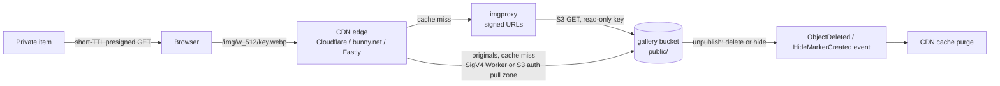

# Serve generated galleries through a CDN with on-the-fly variants

## Workload

Generated-image galleries, community feeds and marketplaces are read-heavy, with long-tail access to old generations. Each image is shown at several sizes and formats. Storing every thumbnail size multiplies object counts, and serving everything directly from origin makes egress unpredictable.

B2 stores one original per image in a private bucket. A CDN fronts it, signs origin requests with a read-only key, and caches variants that imgproxy produces on request. Feeds, counters and caches stay elsewhere.

## Data flow

## B2 zones

| Bucket | Prefix | Versioning / lifecycle | Object Lock | Purpose |
|---|---|---|---|---|
| `<org>-imggen-gallery` | `public/<tenant>/<id>.<ext>` | Keep current; purge hidden versions after N days | No | Approved originals served through the CDN, with `Cache-Control` set at upload |
| `<org>-imggen-gallery` | `private/<tenant>/<id>.<ext>` | Keep | No | Items served only by presigned URL |

Variants are not stored. The source of each item (its run and manifest) stays in the outputs bucket from [generation-output-provenance](../generation-output-provenance/architecture.md); promotion reads the approved original with an outputs-bucket reader key and PUTs it here with the gallery `promoter` key. A cross-bucket server-side copy would need one key with read on the source and write on the destination, which breaks the one-bucket, one-prefix key rule; gallery images are small, so the extra transfer is the cheaper trade-off.

## Boundaries

| Stays off B2 | Where | Why |
|---|---|---|
| Edge cache of originals and variants | CDN | Serves the read volume |
| imgproxy cache | imgproxy or CDN | Re-derivable |
| Gallery and feed database, search index | App database or search service | Queried per request |
| Like and view counters | Redis or app database | High write rate, mutable |
| Worker secrets | CDN secret store | The read-only key never ships in code |

## B2 capability map

| Capability | Status | How it is used |
|---|---|---|
| S3-compatible API | Used | Worker, pull zone and imgproxy read from `https://s3.<region>.backblazeb2.com` |
| Presigned URLs / CORS | Used | Presigned GET for private items; CORS only if the front end fetches images with JavaScript |
| Multipart upload | Not needed | Originals are small |
| Scoped application keys | Used | Read-only keys scoped to `public/` for the CDN and imgproxy |
| Event Notifications | Optional | `b2:ObjectDeleted:*` or `b2:HideMarkerCreated:*` on `public/` triggers CDN purge |
| Object versions | Used | Purge hidden versions after unpublish |
| Lifecycle rules | Used | Delete hidden versions after N days ([example](../../examples/lifecycle-gallery.json)) |
| SSE-B2 | Optional | Transparent to the CDN path |
| Object Lock | Deliberately not used | Takedowns must take effect |
| Cloud Replication | Not used | The CDN absorbs read load; replicate only for DR |
| Egress / CDN / compute partners | Used | B2 offers free egress to CDN partners including Cloudflare, Fastly and bunny.net; confirm current terms on [B2 pricing](https://www.backblaze.com/cloud-storage/pricing) |
| Standard B2 vs Overdrive vs local cache | Standard + CDN cache | Cache hit rate decides origin load; [Overdrive](https://www.backblaze.com/cloud-storage/b2-overdrive) is not usually the bottleneck |

## Integration configuration

Derive every endpoint from the bucket's region: `https://s3.<region>.backblazeb2.com`.

### Cloudflare (Worker for a private bucket)

Backblaze's guide deploys a Worker that SigV4-signs requests to the private bucket's S3 endpoint with a read-only application key stored as Worker secrets. The [cloudflare-b2](https://github.com/backblaze-b2-samples/cloudflare-b2) sample is the reference implementation. Cloudflare is a Bandwidth Alliance partner, which is the basis for free egress on this path.

### bunny.net

bunny.net documents Backblaze B2 as a pull zone origin ([bunny.net guide](https://docs.bunny.net/cdn/integrations/storage/backblaze)). Set the origin to the bucket's S3 URL and enable S3 Authentication with the key ID as access key, the application key as secret, and the bucket's region. Backblaze recommends enabling **Block Root Path Access** so the pull zone does not return a bucket listing.

### Fastly

Deploy the [fastly-b2-rust](https://github.com/backblaze-b2-samples/fastly-b2-rust) sample: a Fastly Compute app that signs origin requests to a private bucket with a read-only application key.

### imgproxy

imgproxy documents S3 sources: `IMGPROXY_USE_S3=true`, `IMGPROXY_S3_ENDPOINT=https://s3.<region>.backblazeb2.com`, `IMGPROXY_S3_REGION=<region>`, and source URLs of the form `s3://<bucket>/<key>`. Its documentation covers MinIO through the same endpoint option. Path-style addressing is the default. Restrict sources with `IMGPROXY_S3_ALLOWED_BUCKETS` and enable URL signing (`IMGPROXY_KEY`, `IMGPROXY_SALT`).

### Scoped keys

| Role | Bucket | Prefix | Capabilities |
|---|---|---|---|
| `cdn-origin` | gallery | `public/` | `readFiles` (add `listFiles` only if the CDN needs it) |
| `imgproxy-reader` | gallery | `public/` | `readFiles` |
| `private-signer` | gallery | `private/` | `readFiles` |
| `promoter` | gallery | `public/` | `writeFiles,deleteFiles` |
| `promoter-source` | outputs | `runs/` | `readFiles` |

## Security

- The bucket stays private; only signed CDN and imgproxy requests reach it.
- Signed imgproxy URLs stop the transformer from being used as an open proxy or a resize-amplification target.
- Private items never go through shared CDN caches; use presigned URLs with short TTLs.
- Purge CDN caches on unpublish and takedown.

## References

- [Deliver private B2 content through Cloudflare CDN](https://www.backblaze.com/docs/cloud-storage-deliver-private-backblaze-b2-content-through-cloudflare-cdn)
- [Integrate bunny.net with B2](https://www.backblaze.com/docs/cloud-storage-integrate-bunnynet-with-backblaze-b2)
- [imgproxy Amazon S3 source](https://docs.imgproxy.net/image_sources/amazon_s3)
- [B2 pricing](https://www.backblaze.com/cloud-storage/pricing)
- [B2 Event Notifications reference](https://www.backblaze.com/docs/cloud-storage-event-notifications-reference-guide)
