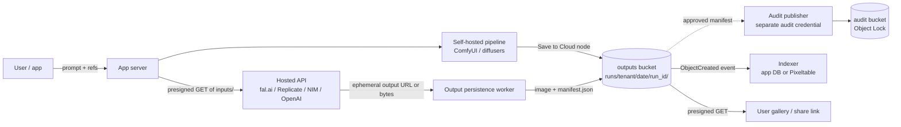
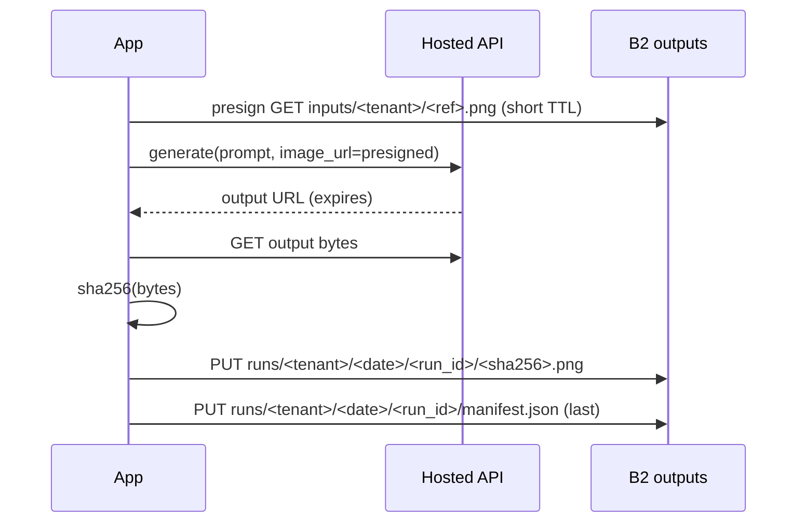

# Generate images and persist every output with provenance manifests

## Workload

Text-to-image and image-editing applications call self-hosted pipelines (ComfyUI, diffusers) or hosted APIs (for example OpenAI gpt-image-1, Google Imagen, or FLUX through Replicate, fal.ai or NVIDIA NIM). Every output must be kept: users return to galleries, remix earlier images, and trust and safety teams audit what was generated, from which prompt and model. Hosted APIs return URLs that expire, so an app that only stores those URLs loses its images.

B2 is the system of record for generated bytes and their provenance manifests. Queues, billing, user databases and caches stay elsewhere.

## Data flow





A manifest records provider, model, prompt, parameters, seed, timestamps, parent asset (for remixes and edits) and the SHA-256 of each output. Writing it last makes it the commit marker: a run without a manifest is incomplete.

## B2 zones

| Bucket | Prefix | Versioning / lifecycle | Object Lock | Purpose |
|---|---|---|---|---|
| `<org>-imggen-outputs` | `inputs/<tenant>/` | Hide after N days, then delete | No | Reference images handed to providers |
| `<org>-imggen-outputs` | `runs/<tenant>/<date>/<run_id>/` | Keep current; purge hidden versions | No | Outputs and `manifest.json` per run |
| `<org>-imggen-outputs` | `assets/<sha256>` | Keep | No | Optional content-addressed layout (dedupes remixes) |
| `<org>-imggen-outputs` | `drafts/<tenant>/` | Hide after N days, then delete ([example](../../examples/lifecycle-outputs.json)) | No | Abandoned or unselected variants |
| `<org>-imggen-audit` | `manifests/<tenant>/<date>/` | Never overwrite | Governance default retention ([example](../../examples/object-lock.json)) | Audit copy of manifests when policy requires immutability |

User outputs stay deletable; the audit bucket holds only manifests, so a user deletion does not conflict with retention of the audit trail. Decide with counsel whether manifests contain personal data (prompts can) before locking them.

## Boundaries

| Stays off B2 | Where | Why |
|---|---|---|
| Request queue and GPU worker state | Redis, SQS or a job runner | Low-latency coordination |
| Rate limits, credits and billing | App database | Transactional |
| Users, galleries and prompt history | SQLite or Postgres (as in the samples) | Queried and edited per request |
| Prompt and result caches | Redis or memory | Latency |
| C2PA signing keys | KMS or HSM | Keys never sit next to the assets they sign |

## B2 capability map

| Capability | Status | How it is used |
|---|---|---|
| S3-compatible API | Used | Application workers, ComfyUI nodes and Pixeltable write through `https://s3.<region>.backblazeb2.com` |
| Presigned URLs / CORS | Used | Presigned GET for provider inputs and private share links; CORS only if browsers fetch with JavaScript |
| Multipart upload | Not needed | Outputs are small; single PUT |
| Scoped application keys | Used | Per-tenant prefix keys or a signer that enforces the tenant prefix |
| Event Notifications | Used | `b2:ObjectCreated:*` on `runs/` triggers indexing and moderation |
| Object versions | Used | Purge hidden versions on user deletion |
| Lifecycle rules | Used | Expire `drafts/` and `inputs/` |
| SSE-B2 | Recommended | Default encryption for user content ([example](../../examples/sse.json)) |
| Object Lock | Used (audit bucket only) | Immutable manifests where policy requires them |
| Cloud Replication | Optional | DR copy of the audit bucket |
| Egress / CDN / compute partners | Used | Public galleries go through a CDN (see [gallery-cdn-delivery](../gallery-cdn-delivery/architecture.md)) |
| Standard B2 vs Overdrive vs local cache | Standard | Many small objects; request rate, not bandwidth, dominates |

## Integration configuration

Derive every endpoint from the bucket's region: `https://s3.<region>.backblazeb2.com`.

### Optional implementation example: Genblaze

[Genblaze](https://github.com/backblaze-labs/genblaze#storage) is one SDK option for the persistence worker. After installing it and configuring a generation pipeline, set `B2_BUCKET` to the private outputs bucket and supply `B2_REGION`, `B2_KEY_ID` and `B2_APP_KEY` through the service environment:

```python
import os
from genblaze_core import KeyStrategy, ObjectStorageSink
from genblaze_s3 import S3StorageBackend

storage = ObjectStorageSink(
    S3StorageBackend.for_backblaze(os.environ["B2_BUCKET"]),
    prefix="",
    key_strategy=KeyStrategy.HIERARCHICAL,
)
# Pass this sink to the configured pipeline: pipeline.run(sink=storage).
```

Set the run's `tenant_id` from authenticated application context. This configuration writes assets and `manifest.json` under `runs/<tenant>/<date>/<run_id>/`; the default SDK layout uses a different root and content-addressed keys. Grant `listBuckets` for its `HeadBucket` preflight. Always transfer output bytes through the sink so the manifest covers their SHA-256 hashes. Keep durable bucket/key/hash references in provenance and presign private objects at read time. The audit publisher copies approved manifests to the separate audit bucket with its own credential; the sink does not perform that cross-bucket step.

### ComfyUI Cloud Storage nodes

Save Image to Cloud writes graph outputs under a `key_prefix` and can return a presigned URL (`presign_url`, `expires_hours`). Use the "Backblaze B2" provider preset. Credentials resolve server-side and never appear in workflow JSON.

### fal.ai

fal's CDN documentation states that presigned S3 or R2 URLs work as file inputs because authentication is embedded in the URL. Pass short-TTL presigned B2 GETs as `image_url` and copy outputs to B2 on completion.

### Replicate

Replicate accepts file inputs as URLs and deletes API output files after one hour. Copy outputs to B2 in the completion handler or webhook, and pass private inputs as short-expiry presigned B2 GET URLs.

### Pixeltable

Pixeltable's cloud-storage documentation has a Backblaze B2 section: destination `https://s3.<region>.backblazeb2.com/<bucket>/<prefix>/`, `b2_profile` in `config.toml`, keys in a `[b2]` AWS credentials profile. Use it to index outputs and computed columns; the bucket stays the system of record.

### Scoped keys

| Role | Bucket | Prefix | Capabilities |
|---|---|---|---|
| `generator-<tenant>` | outputs | `runs/<tenant>/` | `listBuckets,listFiles,readFiles,writeFiles` (`listBuckets` supports SDK preflight) |
| `input-writer` (app upload path, or presigned PUT) | outputs | `inputs/` | `writeFiles` |
| `input-signer` | outputs | `inputs/` | `readFiles` |
| `indexer` | outputs | `runs/` | `listFiles,readFiles` |
| `audit-writer` | audit | `manifests/` | `listFiles,writeFiles` |

For many tenants, one server-side key per service plus a signer that refuses object keys outside the caller's tenant prefix is simpler than one B2 key per tenant.

## Security

- Providers receive presigned GETs with short TTLs, never application keys.
- Treat share links as bearer credentials; log their issuance, not the URLs.
- Verify `X-Bz-Event-Notification-Signature` on indexing webhooks; make handlers idempotent.
- Moderate before outputs become public.

## References

- [Genblaze](https://github.com/backblaze-labs/genblaze)
- [ComfyUI Cloud Storage nodes](https://github.com/backblaze-labs/comfyui-cloud-storage)
- [fal CDN and file inputs](https://fal.ai/docs/documentation/model-apis/fal-cdn)
- [Replicate input files](https://replicate.com/docs/topics/predictions/input-files) and [output files](https://replicate.com/docs/topics/predictions/output-files)
- [Pixeltable cloud storage](https://docs.pixeltable.com/integrations/cloud-storage)
- [B2 Event Notifications](https://www.backblaze.com/docs/cloud-storage-event-notifications-reference-guide)
- [B2 Object Lock](https://www.backblaze.com/docs/cloud-storage-object-lock)
