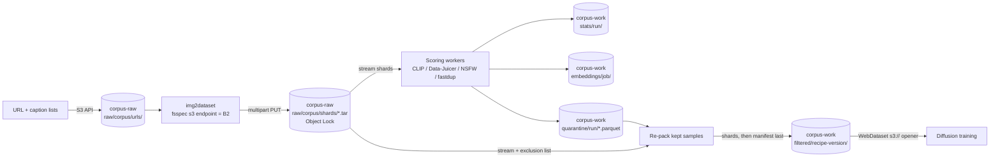

# Collect and curate image-text corpora into streamable training shards

## Workload

Text-to-image models train on image-text pairs: crawled URL and caption lists, licensed collections, or both. A curation team downloads them into tar shards, scores every pair (CLIP similarity, aesthetic or quality score, NSFW probability, near-duplicate clusters) and produces filtered subsets defined by a recipe. Several recipes are compared, so the raw pool must stay fixed and every subset must be reproducible.

B2 holds the raw shards, per-sample scores, embeddings, exclusion lists and filtered subsets. Queues, catalogs, live vector serving and GPU-local caches stay elsewhere.

## Data flow



```mermaid
sequenceDiagram
  participant P as Re-pack job
  participant B as B2 corpus-work
  participant T as Trainer
  P->>B: PUT filtered/<recipe-version>/00000.tar ... N.tar
  P->>B: PUT filtered/<recipe-version>/subset-manifest.json (last)
  T->>B: GET subset-manifest.json
  alt manifest present
    T->>B: GET shards listed in manifest (per-worker, per-node split)
  else manifest missing
    T-->>T: subset incomplete; do not train
  end
```

Samples inside a tar shard cannot be server-side copied one by one, so curation never edits raw shards. Excluded sample keys go to parquet exclusion lists; filtered subsets are new shards. Server-side-copy quarantine applies only to loose files (see the fastdup and CLIP moderation samples).

## B2 zones

| Bucket | Prefix | Versioning / lifecycle | Object Lock | Purpose |
|---|---|---|---|---|
| `<org>-imggen-corpus-raw` | `raw/<corpus>/urls/`, `raw/<corpus>/shards/` | Keep all versions; no expiry | Governance default retention (bucket-level) | Immutable raw pool and download stats |
| `<org>-imggen-corpus-work` | `stats/<run>/` | Hide after N days, then delete ([example](../../examples/lifecycle-corpus-work.json)) | No | Per-sample scores, re-computable |
| `<org>-imggen-corpus-work` | `embeddings/<job>/` | Keep while a subset depends on it | No | `.npy` shards or a LanceDB table |
| `<org>-imggen-corpus-work` | `quarantine/<run>/` | Keep | No | Parquet exclusion lists (sample keys + reason) |
| `<org>-imggen-corpus-work` | `filtered/<recipe-version>/` | Never overwrite; new recipe = new prefix | Optional: move released subsets to a locked bucket | Training subsets + `subset-manifest.json` |

Object Lock and default retention are bucket-level settings, which is why the raw pool gets its own bucket. Lifecycle rules match by file-name prefix, so data that expires sits under its own top-level prefix and nothing that must be kept shares it.

## Boundaries

| Stays off B2 | Where | Why |
|---|---|---|
| Job and shard queue | Ray or Redis | Needs atomic claims and low latency |
| Crawl dedup and robots cache | Key-value store | Per-request lookups |
| Dataset catalog (corpus records, licenses, recipe-to-subset mapping) | Postgres or similar | Relational queries and edits |
| Live vector index serving similarity queries | In-memory FAISS or a vector DB service | Query latency; B2 keeps the durable embedding files |
| Read-ahead cache for active shards | GPU-node NVMe | Repeated epochs over the same subset |

## B2 capability map

| Capability | Status | How it is used |
|---|---|---|
| S3-compatible API | Used | All tools reach B2 through `https://s3.<region>.backblazeb2.com` |
| Presigned URLs / CORS | Used (alternative) | Presigned HTTPS shard URLs for jobs that cannot hold keys; no browser access, so no CORS |
| Multipart upload | Used | Shards of roughly 0.3-1 GB |
| Scoped application keys | Used | `ingest-writer`, `curation`, `training-reader` (below) |
| Event Notifications | Not used | Curation runs are batch-scheduled |
| Object versions | Used | Raw bucket keeps versions; filtered subsets are never overwritten |
| Lifecycle rules | Used | Expire `stats/` scores that can be recomputed |
| SSE-B2 | Optional | Enable when corpora include licensed or sensitive data ([example](../../examples/sse.json)) |
| Object Lock | Used | Raw-corpus bucket only ([example](../../examples/object-lock.json)) |
| Cloud Replication | Not used | Re-downloadable raw data rarely justifies a second copy; add for licensed collections |
| Egress / CDN / compute partners | Situational | Place scoring and training compute near the bucket region; see [B2 pricing](https://www.backblaze.com/cloud-storage/pricing) for egress terms |
| Standard B2 vs Overdrive vs local cache | Standard default | Consider [Overdrive](https://www.backblaze.com/cloud-storage/b2-overdrive) only when measured multi-node shard reads are the training bottleneck; add NVMe read-ahead for repeated epochs |

## Integration configuration

All endpoints are derived from the bucket's region: `https://s3.<region>.backblazeb2.com`. Never copy a region from an example.

### img2dataset (fsspec)

The img2dataset README documents writing to S3-compatible stores through fsspec: set `output_folder` to `s3://<bucket>/<prefix>` and put the endpoint in `~/.config/fsspec/s3.json`:

```json
{"s3": {"client_kwargs": {"endpoint_url": "https://s3.<region>.backblazeb2.com"}}}
```

Credentials come from the standard AWS environment variables holding a B2 application key. Use `output_format` `webdataset` or `parquet`; the `tfrecord` writer does not go through fsspec.

### s3fs (fsspec)

`S3FileSystem(endpoint_url="https://s3.<region>.backblazeb2.com", key=..., secret=...)` is the shared layer for scoring and re-packing jobs. Give each job a B2 application key scoped to the prefixes it reads and writes.

### WebDataset

WebDataset opens shards through gopen (`pipe:` and HTTP URLs), so configure the B2 endpoint in the S3 client it calls. The [Backblaze streaming sample](https://github.com/backblaze-b2-samples/webdataset-streaming-pytorch-training) registers a custom `s3://` opener backed by a boto3 client at the B2 endpoint and splits shards per worker and per node. A `pipe:aws s3 cp --endpoint-url https://s3.<region>.backblazeb2.com s3://<bucket>/<shard>.tar -` URL or presigned HTTPS shard URLs work the same way.

### LanceDB

Use the [pinned LanceDB connection profile](../../examples/lancedb.md) for embedding tables in the corpus-work bucket. It specifies the B2 endpoint, region, credentials and a Lance version whose S3 commit handler requires one writer per table. Serialize ingest, index creation, compaction and other mutations through one writer service. Readers can run separately; serve live queries from a separate index if latency matters. Endpoint settings alone do not establish safe commit behavior across Lance versions.

### Scoped keys

| Role | Bucket | Prefix | Capabilities |
|---|---|---|---|
| `ingest-writer` | corpus-raw | `raw/` | `listFiles,writeFiles` |
| `curation` | corpus-work | (bucket) | `listFiles,readFiles,writeFiles` |
| `curation-raw-reader` | corpus-raw | `raw/` | `listFiles,readFiles` |
| `training-reader` | corpus-work | `filtered/` | `listFiles,readFiles` |
| `takedown-admin` (provisioning only) | corpus-raw | `raw/` | `listFiles,readFiles,deleteFiles,bypassGovernance` |

This design restricts each standard application key to one bucket and one file-name prefix, so a job that reads raw and writes work holds two keys. (B2 also offers multi-bucket keys; least privilege here relies on prefixes.) See [examples/README.md](../../examples/README.md) for the commands.

## Security

- No runtime key can delete raw shards; Object Lock enforces it even if a key leaks.
- Takedowns are honoured through exclusion lists and new subsets. When a legal takedown requires deleting a raw object, the separately held `takedown-admin` key uses `bypassGovernance`; runtime keys never hold that capability.
- Training jobs hold read-only keys for `filtered/` only.
- Presigned shard URLs are bearer credentials; keep TTLs to the job duration and never log them.
- Keep keys in a gitignored `0600` `.env` or a secret store.

## References

- [img2dataset](https://github.com/rom1504/img2dataset)
- [s3fs documentation](https://s3fs.readthedocs.io/en/latest/)
- [WebDataset](https://github.com/webdataset/webdataset)
- [Lance S3 commit-handler implementation for the pinned profile](https://github.com/lance-format/lance/blob/v0.23.2/rust/lance-table/src/io/commit.rs)
- [B2 S3-compatible API](https://www.backblaze.com/docs/cloud-storage-s3-compatible-api)
- [B2 Object Lock](https://www.backblaze.com/docs/cloud-storage-object-lock)
- [B2 lifecycle rules](https://www.backblaze.com/docs/cloud-storage-lifecycle-rules)
- [B2 application keys](https://www.backblaze.com/docs/cloud-storage-application-keys)
