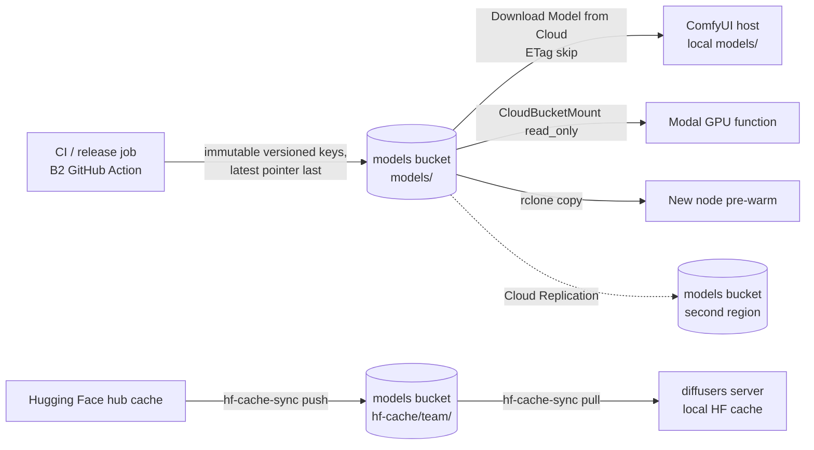
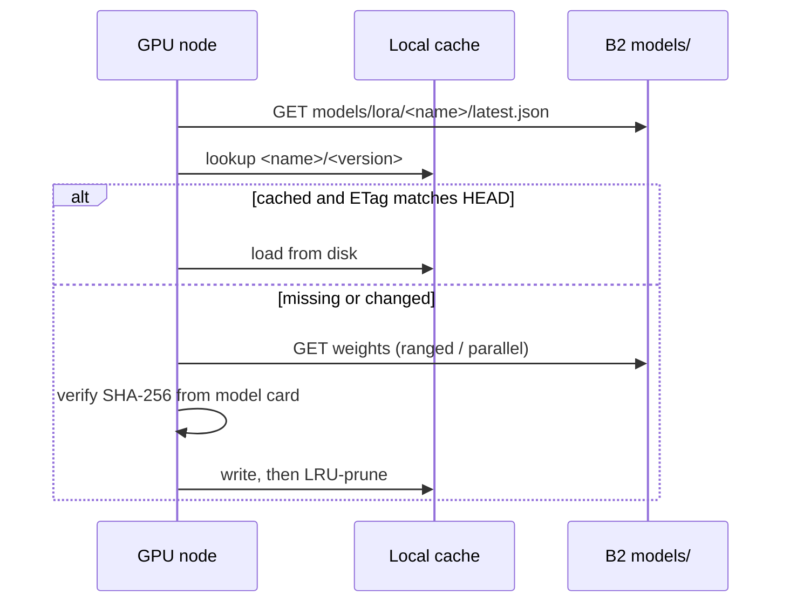

# Distribute base checkpoints and LoRAs to a GPU inference fleet

## Workload

An inference fleet (ComfyUI hosts, diffusers servers, serverless GPU functions) needs base checkpoints, VAEs, ControlNets and a catalog of LoRAs. Base weights are several GB each and LoRA catalogs grow to thousands of files. Pulling from public hubs on every cold start is slow, rate-limited and lets versions drift between nodes.

B2 is the single source of truth for approved weights. Nodes pull into local caches with read-only keys and skip files that have not changed. Runtime model directories, registry metadata and GPU memory stay off B2.

## Data flow





## B2 zones

| Bucket | Prefix | Versioning / lifecycle | Object Lock | Purpose |
|---|---|---|---|---|
| `<org>-imggen-models` | `models/base/<model>/<version>/` | Keep all versions | Per-file retention set by CI (no bucket default) | Base checkpoints with model card, license, SHA-256 |
| `<org>-imggen-models` | `models/lora/<name>/<version>/` | Keep | Per-file retention set by CI (no bucket default) | LoRA adapters |
| `<org>-imggen-models` | `models/vae/`, `models/controlnet/` | Keep | Per-file retention set by CI (no bucket default) | Auxiliary weights |
| `<org>-imggen-models` | `models/<kind>/<name>/latest.json` | Overwritten on each release | No | Mutable pointer, written last |
| `<org>-imggen-models` | `hf-cache/<team>/` | No lifecycle; prune remote revisions manually or with tooling that knows which blobs are referenced | No | Mirrored Hugging Face hub blobs and refs |
| `<org>-imggen-models-<dr>` | same prefixes | Replica | Object Lock enabled if the source has it | Second-region fleet or DR ([example](../../examples/replication.json)) |

Immutable versioned keys plus a small mutable pointer let nodes cache by version forever and still find the newest release.

B2 default retention applies to a whole bucket, and this bucket also holds the mutable `latest.json` pointer and deletable `hf-cache/` blobs. If governance requires locking, enable Object Lock on the bucket without a default retention and have CI set retention on each released file version (the B2 GitHub Action's retention option, which needs `writeFileRetentions`). Pointers and cache blobs then stay deletable. If you need a bucket-wide default instead, publish releases to a separate locked bucket, as [diffusion-finetune-checkpoints](../diffusion-finetune-checkpoints/architecture.md) does.

hf-cache-sync stores content-addressed blobs that later revisions can share, and B2 lifecycle rules expire by upload age, not by last access. Its LRU prune applies to the local disk only, so do not put a lifecycle rule on `hf-cache/`.

## Boundaries

| Stays off B2 | Where | Why |
|---|---|---|
| Model directories the runtime loads from | Node-local NVMe | Loaders expect a local filesystem and fast random reads |
| Model registry metadata (stages, aliases, approvals) | MLflow database or equivalent | Relational state (see [diffusion-finetune-checkpoints](../diffusion-finetune-checkpoints/architecture.md)) |
| ComfyUI workflow JSON | App or git | Shared freely; must contain no credentials |
| Loaded weights | GPU memory | Runtime state |

## B2 capability map

| Capability | Status | How it is used |
|---|---|---|
| S3-compatible API | Used | All pullers use `https://s3.<region>.backblazeb2.com` |
| Presigned URLs / CORS | Not used | Nodes hold read-only keys; no browser access |
| Multipart upload | Used | Multi-GB checkpoints from CI |
| Scoped application keys | Used | CI writes; every worker is read-only on `models/` |
| Event Notifications | Optional | Notify a fleet controller when `latest.json` changes |
| Object versions | Used | Released weights are never overwritten; the pointer is versioned |
| Lifecycle rules | Not used | Never on `models/`; unsafe on `hf-cache/` because blobs are shared across revisions |
| SSE-B2 | Optional | Enable for proprietary weights ([example](../../examples/sse.json)) |
| Object Lock | Optional | Per-file retention on released weights set by CI; no bucket default retention |
| Cloud Replication | Used for multi-region fleets | Bucket-to-bucket copy to a second region; not a delivery mechanism |
| Egress / CDN / compute partners | Situational | Pulls by nodes outside the region count as egress; see [B2 pricing](https://www.backblaze.com/cloud-storage/pricing) |
| Standard B2 vs Overdrive vs local cache | Local cache first | Node caches remove repeat reads. Measure fleet-wide cold starts that pull the same large files at once before considering [Overdrive](https://www.backblaze.com/cloud-storage/b2-overdrive) |

## Integration configuration

Derive every endpoint from the bucket's region: `https://s3.<region>.backblazeb2.com`.

### ComfyUI Cloud Storage nodes

The README documents a "Backblaze B2" provider preset (`COMFY_S3_PROVIDER`, `COMFY_S3_REGION`) or `COMFY_S3_ENDPOINT_URL` for a custom endpoint. Credentials resolve from environment variables or a server-side JSON profile and never appear in workflow JSON. The Download Model from Cloud node pulls into the correct local `models/` directory and skips the download when the remote ETag matches. Read-only access comes from the B2 key you configure, not from the node.

### hf-cache-sync

Configure `storage.endpoint` in YAML, or `B2_ENDPOINT`, `B2_BUCKET` and `B2_REGION` with `B2_APPLICATION_KEY_ID` / `B2_APPLICATION_KEY`. It pushes content-addressed blobs and revision manifests and prunes the local cache by LRU.

### Modal CloudBucketMount

```python
modal.CloudBucketMount(
    "<org>-imggen-models",
    bucket_endpoint_url="https://s3.<region>.backblazeb2.com",
    key_prefix="models/",
    read_only=True,
    secret=modal.Secret.from_name("b2-models-reader"),  # AWS_ACCESS_KEY_ID / AWS_SECRET_ACCESS_KEY = B2 key
)
```

Set `bucket_endpoint_url` to the B2 endpoint and put a read-only B2 application key in the Modal secret. The mount is a network filesystem: for multi-GB weights, copy to the container's local disk at startup rather than loading lazily on the first request.

### rclone

The native B2 backend handles bulk migration of existing checkpoint libraries and pre-warms new nodes (`rclone copy b2:<bucket>/models/base/<model>/<version> /models/...`).

### Publishing from CI

The [Backblaze B2 GitHub Action](https://github.com/backblaze-labs/b2-action) uploads with multipart, verifies SHA-1 and sets Object Lock retention. Upload the version first, then overwrite `latest.json`.

### Scoped keys

| Role | Bucket | Prefix | Capabilities |
|---|---|---|---|
| `ci-publisher` | models | `models/` | `listFiles,readFiles,writeFiles` (+ `writeFileRetentions` if locking) |
| `fleet-reader` | models | `models/` | `listFiles,readFiles` |
| `hf-cache-<team>` | models | `hf-cache/<team>/` | `listFiles,readFiles,writeFiles,deleteFiles` |

## Security

- Only CI holds write keys; a compromised GPU node cannot replace weights.
- Verify SHA-256 from the model card or manifest after download. Multipart ETags are not content MD5s, so ETags are compared for change detection only.
- B2's S3-compatible API does not fully support object tagging; keep model metadata in the card or pointer file, not in tags.
- Never embed credentials in shareable ComfyUI workflows.

## References

- [ComfyUI Cloud Storage nodes](https://github.com/backblaze-labs/comfyui-cloud-storage)
- [hf-cache-sync](https://github.com/backblaze-labs/hf-cache-sync)
- [Modal CloudBucketMount reference](https://modal.com/docs/reference/modal.CloudBucketMount) and [cloud bucket mounts guide](https://modal.com/docs/guide/cloud-bucket-mounts)
- [rclone Backblaze B2](https://rclone.org/b2/)
- [B2 Cloud Replication](https://www.backblaze.com/docs/cloud-storage-cloud-replication)
- [B2 S3-compatible API](https://www.backblaze.com/docs/cloud-storage-s3-compatible-api)
