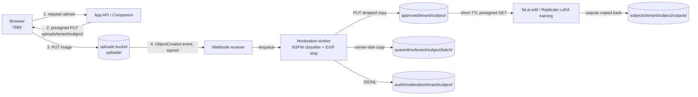

# Ingest, moderate and purge user-uploaded reference images

## Workload

Personalization apps (avatars, headshots, product photography, style transfer) take user uploads: selfies, product shots, reference images. Uploads are personal and sometimes biometric-adjacent. They must be moderated before use, reach model providers only briefly, expire on schedule, and be deletable per subject on request.

B2 holds uploads, moderation outcomes and per-subject outputs. Browsers upload directly to B2 with presigned PUTs, so image bytes never pass through app servers. Auth, consent records, moderation decisions and workers stay elsewhere.

## Data flow



```mermaid
sequenceDiagram
  participant U as User
  participant A as App and consent DB
  participant P as Provider adapters
  participant B as B2 uploads bucket
  U->>A: Delete my data (authenticated tenant and subject)
  A->>A: Mark deleting atomically; block new signing and writer leases
  A->>A: Cancel or drain active uploads, multipart sessions and jobs
  A->>P: Cancel active jobs; delete stored inputs, outputs and trained artifacts
  P-->>A: Deletion confirmed or documented retention expiry reached
  A->>B: ListObjectVersions for uploads, approved, quarantine, subjects and audit subject prefixes
  loop Every version and delete marker, including inventory keys
    A->>B: DeleteObject(key, versionId)
  end
  A->>A: Reconcile late completions under the subject tombstone; repeat cleanup
  A->>B: ListObjectVersions (all subject prefixes) returns empty
  A->>A: Complete only when writers are closed and required provider copies are gone
  A->>A: Record purge request ID, outcome and completion time
```

Approval is a read, strip EXIF (including GPS), then PutObject of the stripped bytes to `approved/<tenant>/<subject>/`. A server-side copy would carry the original metadata to providers, so it is used only for `quarantine/`, where the original bytes are kept for appeal and never presigned. The event rule watches `uploads/` only, so copies into `approved/` and `quarantine/` do not retrigger moderation.

## Subject deletion coordination

The app database stores the subject state (`active`, `deleting`, `deleted`) and an inventory of B2 object keys, version IDs, provider request IDs, and generated model/artifact IDs. Use opaque tenant and subject identifiers in keys. The inventory includes quarantined originals, moderation records, generated outputs, and trained weights.

A deletion request atomically marks the subject `deleting` and prevents new upload URLs, provider handoffs, and worker write leases. Cancel or drain existing uploads and jobs before final reconciliation, including multipart sessions. Workers and event handlers consult the tombstone before committing outputs; late uploads or callbacks are routed to cleanup. Presigned-URL expiry alone does not establish that an upload already in progress has finished.

The purge coordinator uses `writeFiles` to abort multipart uploads and `deleteFiles` to remove stored versions. Keep its credential in the cleanup service. See the [S3 capability mapping](https://www.backblaze.com/docs/cloud-storage-s3-compatible-app-keys).

Each provider adapter records how copied inputs, outputs, and trained artifacts are deleted or expire under that provider's retention policy. Cancel active work, request deletion where available, and retain a pending purge until deletion is acknowledged or the documented data-retention deadline has passed. Expiring a B2 input URL does not delete a provider's copy. A training artifact or model version has its own deletion record.

Delete all versions and delete markers under `uploads/<tenant>/<subject>/`, `approved/<tenant>/<subject>/`, `quarantine/<tenant>/<subject>/`, `subjects/<tenant>/<subject>/`, and `audit/moderation/<tenant>/<subject>/`, plus any additional keys in the inventory. Repeat listings after reconciling late work. Purge retries are idempotent; unresolved writers or provider records keep the request pending. Retain the tombstone to reject retries, and keep only the required deletion receipt under an explicit audit-retention policy.

## B2 zones

| Bucket | Prefix | Versioning / lifecycle | Object Lock | Purpose |
|---|---|---|---|---|
| `<org>-imggen-uploads` | `uploads/<tenant>/<subject>/` | Hide after N days, then delete ([example](../../examples/lifecycle-uploads.json)) | **No** | Raw browser uploads |
| `<org>-imggen-uploads` | `approved/<tenant>/<subject>/` | Expire after training per consent | No | EXIF-stripped, moderated references |
| `<org>-imggen-uploads` | `quarantine/<tenant>/<subject>/<batch>/` | Hide after review window, then delete | No | Rejected items held for appeal |
| `<org>-imggen-uploads` | `subjects/<tenant>/<subject>/outputs/` | Per product retention | No | Generated results for the subject |
| `<org>-imggen-uploads` | `audit/moderation/<tenant>/<subject>/` | Delete with the subject | No | Subject-scoped moderation records (no image bytes) |

Do not enable Object Lock on this bucket. Locked versions cannot be deleted before retention ends, so per-subject purge would fail. SSE-B2 default encryption ([example](../../examples/sse.json)) and CORS for the app origin ([example](../../examples/cors.json)) apply bucket-wide.

## Boundaries

| Stays off B2 | Where | Why |
|---|---|---|
| Auth and user database | App database | Transactional |
| Consent, subject state, object/provider inventory and purge receipts | App database | Coordinates writers, provider cleanup and deletion retries |
| Moderation decisions and appeals | App database | Queried by reviewers |
| Processing queue | Redis, SQS or similar | The webhook must acknowledge fast |
| Classifier workers | GPU or CPU pool | Compute |

## B2 capability map

| Capability | Status | How it is used |
|---|---|---|
| S3-compatible API | Used | Companion, workers and signer use `https://s3.<region>.backblazeb2.com` |
| Presigned URLs / CORS | Used | Presigned PUT for uploads, presigned GET for providers; CORS restricted to the app origin |
| Multipart upload | Optional | Companion can use multipart for large files; selfies rarely need it |
| Scoped application keys | Used | Signer, moderator, provider-signer, purger (below) |
| Event Notifications | Used | `b2:ObjectCreated:*` on `uploads/` to a signed webhook ([example](../../examples/event-notifications.json)) |
| Object versions | Used | Purge deletes every version |
| Lifecycle rules | Used | Expire raw uploads and quarantine |
| SSE-B2 | Used | Default bucket encryption |
| Object Lock | Deliberately not used | Would block verifiable deletion |
| Cloud Replication | Deliberately not used | A replica doubles the purge surface; deletes and hide markers are not replicated |
| Egress / CDN / compute partners | Not used | Uploads are private; never cache them on a CDN |
| Standard B2 vs Overdrive vs local cache | Standard | Small objects, request-bound |

## Integration configuration

Derive every endpoint from the bucket's region: `https://s3.<region>.backblazeb2.com`.

### Uppy + Companion

Companion documents `s3.endpoint` (`COMPANION_AWS_ENDPOINT`) as an optional URL to a custom S3-compatible service. Point it at the B2 endpoint, set the bucket and region, and give it a key that can only write `uploads/`. Uploads go from the browser directly to B2 with presigned requests. Companion's `getKey` hook should build `uploads/<tenant>/<subject>/<uuid>` from the authenticated session, never from client input.

### fal.ai

fal's CDN documentation states that presigned S3 or R2 URLs work as file inputs. Pass short-TTL presigned GETs of `approved/` objects as `image_url`; copy outputs to `subjects/<tenant>/<subject>/outputs/`.

### Replicate

Pass a presigned GET of a zip of approved images as the training input (the [AI Headshot Studio](https://github.com/backblaze-b2-samples/ai-headshot-studio) sample uses this for FLUX LoRA training). Replicate accepts hosted files by URL, so a presigned B2 GET works as the input. Copy trained weights back to B2 before Replicate's output files expire.

### Event Notifications

Configure a rule on `uploads/` for `b2:ObjectCreated:Upload` and `b2:ObjectCreated:MultipartUpload` with an HMAC signing secret. The receiver verifies `X-Bz-Event-Notification-Signature`, enqueues, and responds quickly (the B2 reference guide's example acknowledges within three seconds). Handlers must be idempotent. The [B2 Event Broker](https://github.com/backblaze-b2-samples/b2-event-broker) sample shows fan-out to several subscribers.

### Scoped keys

| Role | Bucket | Prefix | Capabilities |
|---|---|---|---|
| `upload-signer` (Companion) | uploads | `uploads/` | `writeFiles` |
| `moderator` | uploads | (bucket) | `listFiles,readFiles,writeFiles` |
| `provider-signer` | uploads | `approved/` | `readFiles` |
| `purger` | uploads | (bucket) | `listFiles,readFiles,writeFiles,deleteFiles` |
| `notifications-admin` (provisioning only) | uploads | (bucket) | `readBucketNotifications,writeBucketNotifications` |

## Security

- Application keys never reach browsers; presigned PUTs are scoped to one key and expire quickly.
- Strip EXIF, including GPS, before any third-party handoff.
- Quarantined items are never presigned for providers.
- Complete purge only after writer reconciliation, provider cleanup, and an empty all-version listing across every subject prefix. Log the purge request ID, outcome, and completion time; retain identifiers only under the audit policy.
- Keep the signing secret for event webhooks in a secret store.

## References

- [Uppy Companion](https://uppy.io/docs/companion/)
- [fal CDN and file inputs](https://fal.ai/docs/documentation/model-apis/fal-cdn)
- [Replicate input files](https://replicate.com/docs/topics/predictions/input-files)
- [B2 Event Notifications reference](https://www.backblaze.com/docs/cloud-storage-event-notifications-reference-guide)
- [B2 CORS rules](https://www.backblaze.com/docs/cloud-storage-cross-origin-resource-sharing-rules)
- [B2 lifecycle rules](https://www.backblaze.com/docs/cloud-storage-lifecycle-rules)
- [B2 server-side encryption](https://www.backblaze.com/docs/cloud-storage-server-side-encryption)
